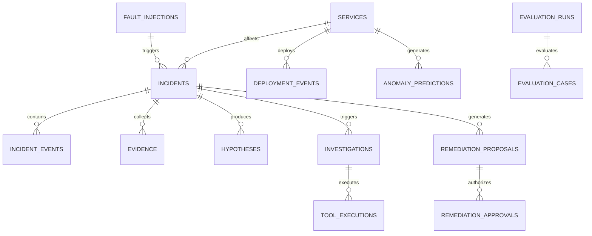

# Wingman AI — Database Design & Schema Specification

The database layer uses SQLAlchemy 2 with async support (`asyncpg` for PostgreSQL, `aiosqlite` for lightweight zero-dependency local development and CI).

## Entity-Relationship Diagram

## Tables & Schema Definitions

### 1. `services`
- `id` (VARCHAR(64), Primary Key) — e.g. `api-gateway`, `checkout-service`
- `name` (VARCHAR(128), Not Null)
- `description` (TEXT)
- `status` (VARCHAR(32), Default 'healthy') — `healthy`, `degraded`, `critical`
- `dependencies` (JSONB / JSON) — array of dependent service IDs
- `created_at` (TIMESTAMP UTC, Not Null)
- `updated_at` (TIMESTAMP UTC, Not Null)

### 2. `incidents`
- `id` (VARCHAR(64), Primary Key) — e.g. `inc-20261111-001`
- `title` (VARCHAR(255), Not Null)
- `severity` (VARCHAR(32), Not Null) — `P1_CRITICAL`, `P2_HIGH`, `P3_MEDIUM`, `P4_LOW`
- `status` (VARCHAR(32), Not Null) — `DETECTED`, `INVESTIGATING`, `IDENTIFIED`, `MITIGATING`, `RESOLVED`, `CLOSED`
- `primary_service_id` (VARCHAR(64), FK -> services.id)
- `affected_service_ids` (JSONB / JSON) — array of service IDs
- `detection_source` (VARCHAR(64)) — `ISOLATION_FOREST`, `LIGHTGBM`, `STATIC_THRESHOLD`, `MANUAL`
- `detected_at` (TIMESTAMP UTC, Not Null)
- `mitigated_at` (TIMESTAMP UTC, Nullable)
- `resolved_at` (TIMESTAMP UTC, Nullable)
- `summary` (TEXT, Nullable)
- `fault_injection_id` (VARCHAR(64), Nullable, FK -> fault_injections.id)

### 3. `incident_events`
- `id` (VARCHAR(64), Primary Key)
- `incident_id` (VARCHAR(64), FK -> incidents.id)
- `event_type` (VARCHAR(64), Not Null) — `ALERT_TRIGGERED`, `INVESTIGATION_STARTED`, `TOOL_CALLED`, `HYPOTHESIS_FORMED`, `REMEDIATION_REQUESTED`, `REMEDIATION_APPROVED`, `RECOVERED`
- `description` (TEXT, Not Null)
- `payload` (JSONB / JSON, Nullable)
- `created_at` (TIMESTAMP UTC, Not Null)

### 4. `evidence`
- `id` (VARCHAR(64), Primary Key) — e.g. `ev-101`
- `incident_id` (VARCHAR(64), FK -> incidents.id)
- `evidence_type` (VARCHAR(32), Not Null) — `METRIC_SPIKE`, `LOG_ERROR`, `TRACE_LATENCY`, `DEPLOYMENT_DIFF`, `RUNBOOK_MATCH`
- `service_id` (VARCHAR(64), FK -> services.id)
- `headline` (VARCHAR(255), Not Null)
- `details` (JSONB / JSON, Not Null)
- `confidence_score` (FLOAT, Default 1.0)
- `timestamp` (TIMESTAMP UTC, Not Null)

### 5. `hypotheses`
- `id` (VARCHAR(64), Primary Key) — e.g. `hyp-01`
- `incident_id` (VARCHAR(64), FK -> incidents.id)
- `rank` (INTEGER, Not Null) — 1, 2, 3
- `root_cause` (VARCHAR(255), Not Null)
- `confidence_score` (FLOAT, Not Null) — calibrated score 0.0 - 1.0
- `explanation` (TEXT, Not Null)
- `supporting_evidence_ids` (JSONB / JSON) — array of evidence IDs
- `contradictory_evidence_ids` (JSONB / JSON)
- `recommended_remediation` (TEXT, Not Null)
- `status` (VARCHAR(32), Default 'PROPOSED') — `PROPOSED`, `VALIDATED`, `REJECTED`, `CONFIRMED`
- `created_at` (TIMESTAMP UTC, Not Null)

### 6. `investigations`
- `id` (VARCHAR(64), Primary Key)
- `incident_id` (VARCHAR(64), FK -> incidents.id)
- `graph_execution_id` (VARCHAR(128))
- `state` (VARCHAR(32), Not Null) — `RUNNING`, `AWAITING_APPROVAL`, `COMPLETED`, `FAILED`
- `current_node` (VARCHAR(64))
- `tokens_used` (INTEGER, Default 0)
- `duration_ms` (INTEGER, Default 0)
- `created_at` (TIMESTAMP UTC, Not Null)
- `updated_at` (TIMESTAMP UTC, Not Null)

### 7. `tool_executions`
- `id` (VARCHAR(64), Primary Key)
- `investigation_id` (VARCHAR(64), FK -> investigations.id)
- `tool_name` (VARCHAR(64), Not Null)
- `parameters` (JSONB / JSON, Not Null)
- `result_summary` (TEXT, Not Null)
- `execution_duration_ms` (INTEGER, Not Null)
- `status` (VARCHAR(32), Not Null) — `SUCCESS`, `FAILED`, `TIMEOUT`
- `created_at` (TIMESTAMP UTC, Not Null)

### 8. `remediation_proposals`
- `id` (VARCHAR(64), Primary Key)
- `incident_id` (VARCHAR(64), FK -> incidents.id)
- `action_type` (VARCHAR(64), Not Null) — e.g. `RESTART_SERVICE`, `RESTORE_CONNECTION_POOL`, `ROLLBACK_DEPLOYMENT`
- `target_service_id` (VARCHAR(64), FK -> services.id)
- `parameters` (JSONB / JSON)
- `justification` (TEXT, Not Null)
- `risk_assessment` (VARCHAR(32), Not Null) — `LOW`, `MEDIUM`, `HIGH`
- `status` (VARCHAR(32), Default 'PENDING_APPROVAL') — `PENDING_APPROVAL`, `APPROVED`, `REJECTED`, `EXECUTED`, `FAILED`
- `created_at` (TIMESTAMP UTC, Not Null)

### 9. `remediation_approvals`
- `id` (VARCHAR(64), Primary Key)
- `proposal_id` (VARCHAR(64), FK -> remediation_proposals.id)
- `decision` (VARCHAR(32), Not Null) — `APPROVED`, `REJECTED`
- `operator_notes` (TEXT, Nullable)
- `executed_at` (TIMESTAMP UTC, Nullable)
- `execution_output` (TEXT, Nullable)
- `verification_status` (VARCHAR(32), Default 'PENDING') — `VERIFIED_HEALTHY`, `REGRESSION_DETECTED`

### 10. `fault_injections`
- `id` (VARCHAR(64), Primary Key)
- `fault_type` (VARCHAR(64), Not Null)
- `target_service_id` (VARCHAR(64), FK -> services.id)
- `intensity` (FLOAT, Not Null)
- `parameters` (JSONB / JSON)
- `status` (VARCHAR(32), Not Null) — `ACTIVE`, `STOPPED`, `EXPIRED`
- `expected_root_cause` (VARCHAR(255), Not Null)
- `started_at` (TIMESTAMP UTC, Not Null)
- `ended_at` (TIMESTAMP UTC, Nullable)

### 11. `model_versions` & `evaluation_runs`
- Stores ML model artifacts, metrics (F1, Precision, Recall, AUC), training timestamps, evaluation benchmark cases, Top-1/Top-3 accuracies, and regression deltas.
